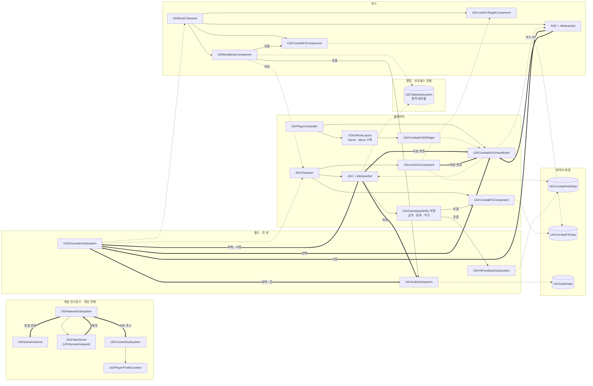
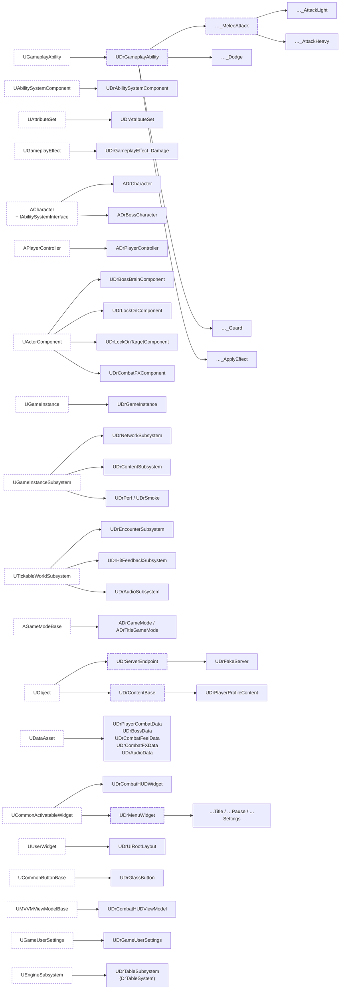
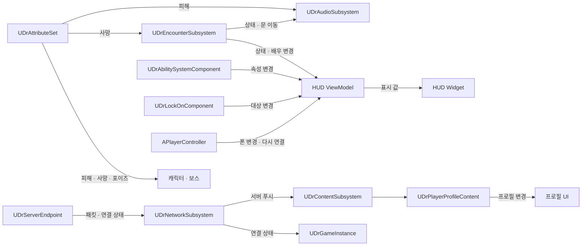
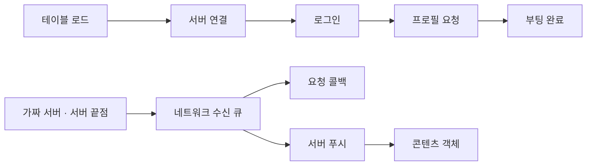
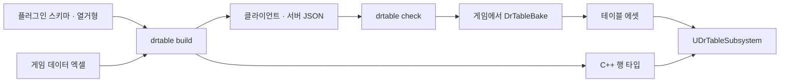
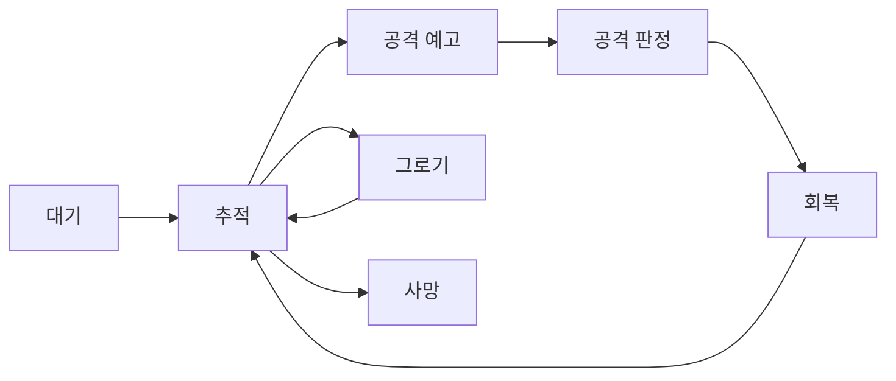
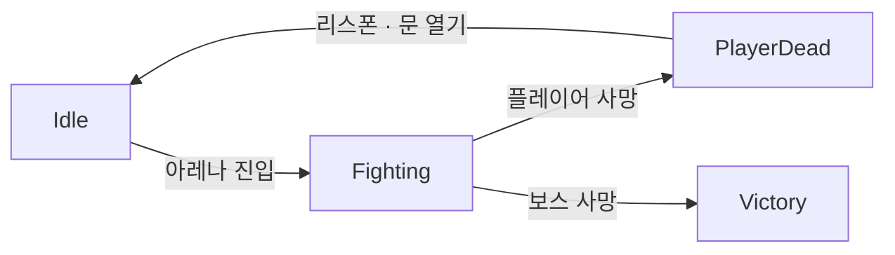

# DrFramework

언리얼 엔진의 범용 게임 런타임 프레임워크와 최소 검증용 샘플 프로젝트다. 부팅·네트워크·정적 테이블·콘텐츠·UI·엔카운터·오디오·검증 기반을 제공한다. 근접 전투와 보스 등은 포함된 예시 구현이며, 필요 없으면 빼거나 바꿔 쓴다.

## AI용 설계 명세서 내려받기

이 파일 하나만 AI 에이전트에 주면 다른 엔진 버전에서도 같은 구조로 만들 수 있도록 구성했다. 실제 코드는 UE 5.8.2에서 검증했으며, 다른 버전에서는 명세서의 재현 절차에 따라 엔진 API와 빌드 설정을 조정한다.

- [최신(main) 명세서](https://raw.githubusercontent.com/ldnjin81/DrFramework/main/Docs/FRAMEWORK_FOR_AI.md): 링크를 열어 다른 이름으로 저장하면 바로 받는다.
- [버전별 명세서 — GitHub Releases](https://github.com/ldnjin81/DrFramework/releases): 각 릴리스에 `FRAMEWORK_FOR_AI.md`를 첨부하는 배포 기준이다.
- [저장소 안에서 읽기](Docs/FRAMEWORK_FOR_AI.md)

## 구성과 시스템 범위

프레임워크 플러그인은 `Dr`, 소비 게임 모듈은 자기 접두사를 쓴다. 게임은 프레임워크를 넣고 필요한 클래스를 상속·설정한다.

| 위치 | 역할 |
| --- | --- |
| `Plugins/DrFramework` | 프레임워크 런타임과 생성 테이블 타입 |
| `Plugins/DrTableSystem` | [DrTableSystem](https://github.com/ldnjin81/DrTableSystem) 0.10.0 런타임·에디터 지원 |
| `Source/DrSample` | 모듈 등록만 하는 최소 검증 호스트 |
| `Plugins/DrFramework/Tables/Schemas`, `Enums` | 프레임워크 소유 스키마와 열거형 |
| `Design/Tables` | 게임 소유 샘플 데이터. GameAssets 경로는 비어 있음 |
| `Docs/FRAMEWORK_FOR_AI.md` | 다른 엔진에서도 재현할 수 있도록 쓴 AI용 설계 명세서 |
| `Docs/EXTRACTION_REPORT.md`, `rename_map.csv` | 추출 결과, 이식·보류 테스트와 이름 대응표 |

| 구분 | 포함 시스템 | 사용 방법 |
| --- | --- | --- |
| 장르 무관 공통 기반 | 부팅, 네트워크·가짜 서버, 테이블, 콘텐츠 캐시, UI·설정, 엔카운터, 오디오, 디버그·검증 | 게임의 수명·데이터·화면·흐름에 맞춰 상속·설정 |
| 포함된 예시 구현 | GAS 속성·효과, 근접 공격·회피·막기, 캐릭터·락온·타격감, 보스 패턴·전투 FX | 필요 없으면 빼거나 바꿔 쓴다. 특정 장르 사용을 요구하지 않는다 |

## 현재 검증 상태

UE 5.8.2에서 `DrSampleEditor Win64 Development` 빌드 성공, 콘텐츠 없는 헤드리스 `DrFramework` 자동화 64/64 성공. 실제 콘텐츠·PIE 검증과 구운 테이블은 소비 게임 단계다. [추출 보고서](Docs/EXTRACTION_REPORT.md)에 제외·부분 이식 항목을 기록했다.

## 콘텐츠

저장소에는 코드와 직접 만든 데이터만 들어 있다. 마네킹·애니메이션 같은 Epic 콘텐츠는 라이선스상 공개 저장소에 다시 배포할 수 없으므로,
각자 설치한 Lyra Starter Game·Game Animation Sample에서 `Content/Epic/`으로 복사해 쓴다(복사 도구 준비 중).

## 게임에 연결하기

`DrSample`은 모듈 등록만 하는 검증 호스트다. 소비 게임이 BP·맵·DataAsset·입력과 실제 콘텐츠를 공급한다.

1. 게임에 `DrFramework`와 `DrTableSystem` 플러그인을 넣고 활성화한다.
2. 게임 모듈의 `Build.cs`에 `DrFramework` 의존성을 추가한다.
3. 샘플 `Config`를 참고해 GameInstance·사용자 설정·CommonUI·EnhancedInput을 연결한다.
4. 게임 클래스를 필요한 `Dr` 클래스에서 상속하고 데이터와 에셋을 설정한다.
5. 스키마에서 테이블 코드를 생성하고 게임 데이터의 참조를 검사한다.
6. 에셋을 공급한 게임에서 테이블 굽기·PIE·패키지 검증을 수행한다.

샘플의 핵심 클래스 설정은 다음과 같다.

```ini
[/Script/EngineSettings.GameMapsSettings]
GameInstanceClass=/Script/DrFramework.DrGameInstance

[/Script/Engine.Engine]
GameUserSettingsClassName=/Script/DrFramework.DrGameUserSettings
```

CommonUI viewport·입력 설정은 [샘플 Config](Config)를 따른다. 맵·UI·Cook 경로는 게임이 정한다.
보스 데이터는 `BossAssetKey` 또는 `BossData`로 선택하며, 기본 키와 이름은 `Boss` / `보스`다.

플러그인이 요구하는 기능은 GAS, EnhancedInput, CommonUI, MVVM, AudioModulation,
MetaSound, Niagara, EngineCameras, PoseSearch, Chooser, MotionWarping과 DrTableSystem이다.
정확한 목록은 [플러그인 선언](Plugins/DrFramework/DrFramework.uplugin)과
[모듈 의존성](Plugins/DrFramework/Source/DrFramework/DrFramework.Build.cs)을 따른다.

다른 엔진에서는 `EngineAssociation`과 Target의 빌드 설정을 먼저 맞춘다.
구체적인 재현 순서는 [명세서의 플러그인 배포·재현 명세](Docs/FRAMEWORK_FOR_AI.md#플러그인-배포재현-명세-1단계)를 본다.

## 전체 구조

객체의 수명에 따라 책임을 나눈다. 맵을 넘어 유지할 상태는 게임 인스턴스에,
한 판의 상태는 월드에, 액터 고유 상태는 컴포넌트에 둔다.

| 수명 | 주요 객체 | 책임 |
| --- | --- | --- |
| 엔진 | `UDrTableSubsystem` | 정적 테이블 등록·로드·조회 |
| 게임 인스턴스 | `UDrGameInstance` | 부팅 흐름 |
| 게임 인스턴스 | `UDrNetworkSubsystem`, `UDrFakeServer` | 요청·응답·지연 큐·연결 상태 |
| 게임 인스턴스 | `UDrContentSubsystem` | 서버 데이터 캐시와 푸시 분배 |
| 게임 인스턴스 | `UDrPerfSubsystem`, `UDrSmokeSubsystem` | 명령줄로 켜는 패키지 검증 |
| 월드 | `UDrEncounterSubsystem` | 체크포인트·문·사망·승리 |
| 월드 | `UDrHitFeedbackSubsystem`, `UDrAudioSubsystem` | 타격감과 소리 |
| 컨트롤러 | `ADrPlayerController` | UI 스택·HUD·일시정지·설정 |
| 액터 | `ADrCharacter`, `ADrBossCharacter`와 컴포넌트 | 속성·행동·표현 |

**월드 규칙:** 월드 서브시스템은 Game·PIE 월드에서만 동작한다.
서로의 상태를 반복 조회하기보다 이벤트를 구독한다.

### 관계 지도

묶음은 수명 범위, 원통은 데이터다. 실선은 소유, 점선은 참조,
굵은 선은 이벤트 알림 방향이다. `호출` 선은 규칙이 표현을 직접 부르는 길이다.



### 상속 관계

공통 기반이 필요한 어빌리티·메뉴·서버 끝점·콘텐츠에 추상 클래스를 둔다.
점선 테두리는 엔진 클래스, 굵은 점선 테두리는 추상 기반이며 화살표는 부모에서 자식으로 향한다.



### 이벤트 연결

속성·상태 변화가 HUD와 오디오로 전달된다. 컨트롤러의 폰이 바뀌면 HUD의 구독도 다시 연결한다.



직접 호출은 규칙에서 표현으로 향한다. 어빌리티·보스 두뇌가 FX·타격감·오디오를 부르며,
표현 계층은 전투 규칙을 결정하지 않는다.
세부 소유·약참조 목록은 [명세서 1절](Docs/FRAMEWORK_FOR_AI.md#1-수명-계층과-소유-관계)을 본다.

## 부팅과 서버 데이터

가짜 서버부터 실서버와 같은 요청·응답 경로를 쓴다.
게임은 콘텐츠 객체를 조회하므로 서버 구현을 교체해도 데이터 사용 방식이 유지된다.



- `UDrServerEndpoint` — 서버 구현을 바꾸는 경계다.
- `UDrNetworkSubsystem` — 요청 번호·콜백·시간 초과와 연결 상태를 관리한다.
- `UDrFakeServer` — 지연·실패를 주입해 로컬에서 통신을 검증한다.
- `UDrContentSubsystem` — 푸시를 해당 콘텐츠 객체에 전달한다.
- `UDrPlayerProfileContent` — 프로필을 보관하고 변경 이벤트를 보낸다.

네트워크 틱은 월드와 독립적이어서 맵 전환 중에도 진행된다.
새 메시지는 종류·페이로드·서버 처리·콘텐츠 처리·실패 테스트를 함께 추가한다.

요청 시그니처·시간 초과·지연 기본값은 [명세서 2절](Docs/FRAMEWORK_FOR_AI.md#2-부팅동적-데이터-서버형-단방향)을 본다.

## 데이터 테이블

[DrTableSystem](https://github.com/ldnjin81/DrTableSystem) 0.10.0을 사용한다.
프레임워크는 스키마와 열거형을 소유하고, 게임은 데이터 값을 소유한다.
스키마 변경은 코드 생성으로, 데이터 변경은 생성·검사·굽기로 반영한다.



| 구성 | 역할 |
| --- | --- |
| `Plugins/DrFramework/Tables/Schemas`, `Enums` | 필드·타입·참조·열거형 정의 |
| `Design/Tables` | 게임 소유 데이터 엑셀 |
| `TableData/Generated` | 생성 행 타입과 등록 코드. 직접 수정하지 않음 |
| `UDrTableSubsystem` | 등록·로드·키 조회. 별도 레지스트리 객체 없음 |
| `UDrTableSettings` | 구운 에셋 위치와 로드 정책 |
| `DrTableEditor` | 굽기와 패키지 쿡 지원 |

생성기 실행 파일을 지정해 저장소 루트에서 실행한다.

```powershell
.\Tools\gen_tables.ps1 -DrTable <drtable-0.10.0-실행파일>
```

등록은 `DrTables.cpp` 한 곳에서 처리한다.
행 조회는 생성 타입을 통해 서브시스템에 전달되며, 테스트에서는 독립 인스턴스와 행 주입을 쓴다.

현재 샘플의 `GameAssets`에는 `Player`, `PlayerCombat`, `CombatFX`, `Boss` 키만 있고 경로는 비어 있다.
게임이 에셋 경로를 채우고 별도로 굽는다. 이번 추출 단계에는 구운 테이블이 없다.

시트 문법·등록 매크로·참조 접근자·굽기와 쿡 규칙은
[명세서 3절](Docs/FRAMEWORK_FOR_AI.md#3-정적-데이터-drtable-플러그인)을 본다.

## 게임플레이 예시 구현

다음 시스템은 필요에 따라 빼거나 교체한다. 장르와 전투 방식을 프레임워크 전체의 전제로 삼지 않는다.

### GAS·속성·상태 효과

`UDrAbilitySystemComponent`와 `UDrAttributeSet`이 능력·속성·상태 변화를 관리한다.
생명력·기력·포이즈 등은 전투 예시의 값이며, 게임에 맞는 속성으로 확장할 수 있다.

- 기본 특성과 장비·효과 배율에서 최종 스탯을 계산한다.
- 피해 처리에서 방어·막기·보호막·포이즈와 사망 이벤트를 일관되게 적용한다.
- `EffectDefs` 데이터로 지속·주기 효과와 중첩 규칙을 정의한다.
- 상태 태그와 어빌리티 태그로 실행 가능 여부와 충돌을 제어한다.

공식·효과 필드·태그 전체 목록은 [명세서 4–8절](Docs/FRAMEWORK_FOR_AI.md#4-게임플레이-태그-coredrgameplaytags-네이티브-선언)을 본다.

### 어빌리티

공통 기반은 비용·쿨다운·태그와 실행 수명을 처리한다.
근접 공격·회피·막기·효과 적용은 그 기반을 쓰는 예시다.

- 근접 공격 — 입력 버퍼·콤보와 타격 구간을 틱으로 진행한다.
- 회피 — 방향을 선택하고 무적·이동을 적용한다.
- 막기·쳐내기 — 입력 시점과 피격 방향을 판정한다.
- 효과 적용 — 테이블에서 효과를 찾아 대상에게 적용한다.

게임 규칙의 시간은 누적 틱으로 계산한다. 긴 틱에서도 구간 겹침으로 판정해 타격을 놓치지 않는다.
몽타주가 없어도 이동·판정의 대체 경로가 동작하므로 화면 없이 검증할 수 있다.

정확한 입력·판정 시각과 파생 클래스 구현 지점은 [명세서 8절](Docs/FRAMEWORK_FOR_AI.md#8-어빌리티)을 본다.

### 플레이어 캐릭터

`ADrCharacter`는 ASC·속성·락온·전투 FX와 카메라를 묶는다.
게임은 입력 액션과 기본 어빌리티, 메시·애니메이션·전투 데이터를 공급한다.

피격·경직·그로기·사망은 속성 이벤트에 반응한다.
로코모션과 몽타주는 표현 계층에 두며, 전투 규칙이 애니메이션 노티파이에 의존하지 않게 한다.

BP 결선과 모션 연결은 [명세서 9절](Docs/FRAMEWORK_FOR_AI.md#9-플레이어-캐릭터-adrcharacter)과
[부록 A](Docs/FRAMEWORK_FOR_AI.md#부록-a-부트스트랩--빈-프로젝트에서-같은-뼈대-세우기)를 본다.

### 보스

`ADrBossCharacter`가 속성과 표현을, `UDrBossBrainComponent`가 권한 측 의사결정을 담당한다.
보스 이름·스탯·애니메이션은 데이터로 공급하고 페이즈·공격은 테이블로 정한다.



패턴은 거리·쿨다운·가중치로 고르며 페이즈에 따라 패턴 묶음을 바꾼다.
테스트는 테이블 행과 난수 시드를 주입해 결과를 재현한다.

상태 전이·공격 필드·페이즈 조건은 [명세서 10절](Docs/FRAMEWORK_FOR_AI.md#10-보스)을 본다.

### 락온·타격감·FX

- `UDrLockOnComponent` — 거리·시야·가림을 고려해 대상을 고르고 카메라 설정을 복구한다.
- `UDrLockOnTargetComponent` — 잠글 수 있는 대상과 시선 위치를 제공한다.
- `UDrHitFeedbackSubsystem` — 히트스톱·화면 흔들림·피격 번쩍임을 적용한다.
- `UDrCombatFXComponent` — 검광·예고·임팩트·회피 잔상과 생성한 효과의 수명을 관리한다.
- `UDrCombatFeelData`, `UDrCombatFXData` — 감각과 시각 효과를 데이터로 조절한다.

히트스톱 복구는 월드의 실제 시간으로 잰다. 느려진 액터 자신의 시간에 복구를 맡기지 않는다.
어빌리티와 보스 두뇌는 효과를 직접 생성하는 대신 표현 컴포넌트에 의도를 전달한다.

기본 수치·소켓·효과 목록은 [명세서 11절](Docs/FRAMEWORK_FOR_AI.md#11-락온타격감fx)을 본다.

## 엔카운터

`UDrEncounterSubsystem`은 한 판의 상태와 체크포인트·문·재도전 흐름을 관리한다.
현재 연결 예시는 보스 전투이며, 게임의 진행 방식에 맞게 바꿔 쓴다.



액터 태그 `Dr.Boss`, `Dr.Checkpoint.Gate`, `Dr.Arena.Door`, `Dr.Player.Start`로 배우를 찾는다.
필수 배우가 없으면 엔카운터는 시작하지 않는다.
체크포인트를 활성화하면 이후 리스폰 위치로 사용한다.

상태·배우·문 이동 이벤트를 HUD와 오디오가 구독한다.
메뉴의 재도전도 같은 리스폰 진입점을 사용해 흐름을 중복 구현하지 않는다.

거리·시간·초기화 조건은 [명세서 12절](Docs/FRAMEWORK_FOR_AI.md#12-엔카운터-udrencountersubsystem)을 본다.

## 오디오

`UDrAudioSubsystem`은 음악 상태, 전투음·환경음과 채널 음량을 관리한다.
`UDrAudioData`가 필요한 소리·버스·감쇠 데이터를 보유한다.

- MetaSound와 AudioModulation으로 효과음·목소리·음악 채널을 조절한다.
- 사용자 음량은 `UDrGameUserSettings`에 저장한다.
- 엔카운터와 피해 이벤트를 구독해 교전·사망·승리와 피격에 반응한다.
- 보스 공격·페이즈 표현은 보스 두뇌의 호출로 시작한다.

에셋 결선과 이벤트별 재생 규칙은 [명세서 13절](Docs/FRAMEWORK_FOR_AI.md#13-오디오-udraudiosubsystem--udraudiodata)을 본다.

## UI

`ADrPlayerController`가 CommonUI의 게임 스택과 메뉴 스택을 소유한다.
HUD는 MVVM으로 표시 값을 받고 메뉴는 공통 기반에서 입력·포커스·뒤로가기를 처리한다.

| 구성 | 역할 |
| --- | --- |
| `UDrUIRootLayout` | HUD와 모달 메뉴의 스택 |
| `UDrMenuWidget` | 메뉴 공통 동작과 확장 지점 |
| 타이틀·일시정지·설정 메뉴 | 시작·계속·재도전·음량 설정 예시 |
| `UDrGlassButton` | 마우스·키보드·패드의 공통 포커스 표현 |
| `UDrCombatHUDViewModel` | 속성·엔카운터·락온 이벤트를 표시 값으로 변환 |
| `UDrCombatHUDWidget` | 게이지·상태·결과 화면 표시 |

HUD는 매 틱 게임 상태를 긁어 오지 않는다. ViewModel이 이벤트를 받고 위젯은 표시 값만 읽는다.
폰 교체 시 구독을 다시 묶어 리스폰 뒤에도 갱신된다.

메뉴 확장·HUD 필드·잔상 타이밍은 [명세서 14절](Docs/FRAMEWORK_FOR_AI.md#14-ui-commonui--mvvm-리퀴드-글라스)을 본다.

## 검증과 디버그

현재 이식한 자동화는 콘텐츠 없는 경량 월드와 in-memory 데이터로 실행한다.
콘텐츠·PIE·패키지가 필요한 검증은 소비 게임 단계에서 수행한다.
전체 기능의 기대 결과와 현재 이식 범위를 구분해 확인한다.

1. `DrSampleEditor Win64 Development`를 UE 5.8에서 빌드한다.
2. 인터랙티브 에디터를 종료한다.
3. 다음처럼 헤드리스 자동화를 실행한다.
4. 실제 실행 개수·성공·실패 수를 확인한다.

```powershell
& '<UE_5.8>\Engine\Binaries\Win64\UnrealEditor-Cmd.exe' `
  '<저장소>\DrFramework.uproject' `
  '-ExecCmds=Automation List; RunTests DrFramework' `
  '-TestExit=Automation Test Queue Empty' -nullrhi -unattended -log
```

테스트는 독립 월드·테이블 인스턴스·난수 시드·입력 진입점으로 재현성을 확보한다.
테스트별 기대 결과는 [명세서 부록 C](Docs/FRAMEWORK_FOR_AI.md#부록-c-테스트-명세-다시-만든-코드가-통과해야-할-기대-결과),
이식·보류 내역과 실행 증거는 [추출 보고서](Docs/EXTRACTION_REPORT.md)를 본다.

주요 진단 진입점은 다음과 같다.

| 진입점 | 용도 |
| --- | --- |
| `Dr.Net.Ping`, `Dr.Profile.Request` | 연결과 프로필 요청 확인 |
| `Dr.Net.SetLatency`, `Dr.Tables.Reload` | 네트워크 조건 변경·테이블 재로드 |
| `DrTable.Status`, `DrTable.Reload` | 테이블 등록·로드 상태 확인 |
| `-DrAutoNetSmoke` | 부팅·네트워크 흐름 점검 |
| `-DrSmokeTest`, `-DrPerfCapture` | 게임 콘텐츠를 연결한 패키지 검증 |
| `-DrMenuCapture`, `-DrCaptureAudio` | 화면·소리 검증 지원 |

플래그별 동작과 출력은 [명세서 15절](Docs/FRAMEWORK_FOR_AI.md#15-검증-지원-코드)을 본다.

## 확장과 이름 규칙

새 기능은 데이터·코드·표현·테스트를 함께 연결한다.

| 확장 대상 | 작업 흐름 |
| --- | --- |
| 플레이어 기술 | 어빌리티 파생 → 비용·태그 → 판정 → 입력 등록 → 테스트 |
| 보스 공격 | 공격 행 → FX·소리 → 테이블 주입 테스트 |
| 상태 효과 | 태그 → 효과 행 → 적용 → HUD·FX |
| 서버 데이터 | 메시지·페이로드 → 서버 처리 → 콘텐츠 객체 → 지연·실패 테스트 |
| 메뉴 | 메뉴 파생 → 스택 연결 → 포커스·뒤로가기 확인 |

프레임워크 클래스·구조체·열거형은 `Dr`, 게임 모듈은 자기 접두사를 사용한다.
`State.*`, `Ability.*`, `Data.*` 공용 태그는 유지하고 프레임워크 콘솔·명령줄은 `Dr`를 쓴다.
소비 게임으로 옮길 때의 기존 이름 대응은 [rename_map.csv](Docs/rename_map.csv)를 참고한다.

상세 확장 순서는 [명세서 16절](Docs/FRAMEWORK_FOR_AI.md#16-확장-레시피),
파일·에셋·도구의 이름 규칙은 [17절](Docs/FRAMEWORK_FOR_AI.md#17-네이밍-규칙-코드에셋도구문서-공통),
엔진 버전별 주의점은 [18절](Docs/FRAMEWORK_FOR_AI.md#18-ue-58-c-함정)을 본다.
