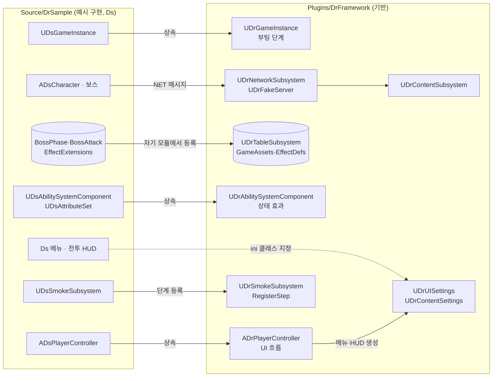

# DrFramework

장르와 무관한 언리얼 엔진 게임 런타임 프레임워크와, 그 위에 게임을 얹는 방법을 보여 주는 샘플 프로젝트다.

- **플러그인 `DrFramework`** — 부팅 흐름·네트워크·가짜 서버·정적 테이블·콘텐츠 등록·UI 흐름·상태 효과·검증 틀 같은 재사용 기반만 담는다. 샘플 없이 단독으로 빌드·테스트된다.
- **샘플 모듈 `DrSample`(접두사 `Ds`)** — 기반 클래스를 상속해 만든 포함된 예시 구현이다. 근접 전투·보스·락온·엔카운터·오디오·글래스 UI가 여기에 있다. 필요 없으면 빼고 자기 게임 모듈로 바꾼다.

의존 방향은 `DrSample → DrFramework → DrTableRuntime` 한 방향뿐이다.

## AI용 설계 명세서 내려받기

이 파일 하나만 AI 에이전트에 주면 다른 엔진 버전에서도 같은 기반 구조를 만들 수 있도록 구성했다. 실제 코드는 UE 5.8.2에서 검증했으며, 다른 버전에서는 명세서의 재현 절차에 따라 엔진 API와 빌드 설정을 조정한다.

- [최신(main) 명세서](https://raw.githubusercontent.com/ldnjin81/DrFramework/main/Docs/FRAMEWORK_FOR_AI.md): 링크를 열어 다른 이름으로 저장하면 바로 받는다.
- [버전별 명세서 — GitHub Releases](https://github.com/ldnjin81/DrFramework/releases): 각 릴리스에 `FRAMEWORK_FOR_AI.md`를 첨부한다.
- [저장소 안에서 읽기](Docs/FRAMEWORK_FOR_AI.md)

| 문서 | 내용 |
| --- | --- |
| [설계 명세서](Docs/FRAMEWORK_FOR_AI.md) | 플러그인(기반)만 다룬다. 이것만 읽어도 다른 장르 게임을 시작할 수 있다 |
| [샘플 설계 설명서](Docs/SAMPLE_DESIGN.md) | 기반 → Ds 파생 → 재정의 대응표, 샘플 전용 시스템의 상세 동작·수치·테스트 기대값 |
| [샘플 인계 노트](Docs/SAMPLE_NOTES.md) | Lyra 콘텐츠 가져오기와 샘플 콘텐츠 상태, 후속 확인 항목 |
| [rename_map.csv](Docs/rename_map.csv) | ProjectDT `Dt` → `Dr` → `Ds` 이름 대응표(기존 게임 전환용) |

## 구성

| 위치 | 역할 |
| --- | --- |
| `Plugins/DrFramework` | 기반 런타임(접두사 `Dr`, `DRFRAMEWORK_API`) |
| `Plugins/DrFramework/Tables` | 기반 테이블 스키마(GameAssets·EffectDefs)와 공통 열거형 |
| `Plugins/DrTableSystem` | [DrTableSystem](https://github.com/ldnjin81/DrTableSystem) 0.10.0 런타임·에디터 |
| `Source/DrSample` | 예시 구현(접두사 `Ds`, `DRSAMPLE_API`), 샘플 테이블 스키마(`Tables`), PIE 검증 |
| `Design/Tables` | 기반 테이블의 샘플 데이터(GameAssets 경로·효과 정의) |
| `Content/DrSample`, `Content/Data` | 샘플 BP·맵·입력·몽타주·DataAsset, 구운 테이블 |
| `Tools` | 테이블 생성(`gen_tables.ps1`), Lyra 콘텐츠 가져오기, 샘플 콘텐츠 생성 |

### 무엇이 어디에 있나

| 영역 | 플러그인(기반) | 샘플(예시 구현) |
| --- | --- | --- |
| 게임 인스턴스 | 부팅 단계 실행기(`GetBootSteps`·`ExecuteBootStep`·`CompleteBootStep`) | 연결→Ping→로그인→프로필 단계 |
| 게임 모드 | `ADrGameMode`(폰 미지정) | `ADsGameMode`(캐릭터·컨트롤러 지정), 타이틀 게임 모드 |
| 사용자 설정 | 저장 틀과 `ApplyGameSettings` 훅 | SFX·Voice·Music 음량 |
| 네트워크·가짜 서버 | 요청 Id·타임아웃·지연 큐, `RegisterHandler(Id, 처리기)` | 메시지 ID(`DsMessages`), 로그인·프로필 처리기 |
| 콘텐츠 | `UDrContentBase`·서브시스템, `UDrContentSettings` 등록 목록 | `UDsPlayerProfileContent` |
| 테이블 | GameAssets·EffectDefs, 등록 1곳 | BossPhase·BossAttack·EffectExtensions, 등록 1곳 |
| GAS | 틱 어빌리티, ASC 골격, 상태 효과(배수·누적·만료·쿨다운) | 속성 세트, 스탯 공식, 피해 GE, 기력·포이즈, 근접·회피·막기 |
| 캐릭터 | ASC를 가진 `ADrCharacter` 골격 | `ADsCharacter`(입력·카메라·락온·전투 FX), 보스 |
| UI | 화면 층, 메뉴 동작, HUD 기반, `UDrUISettings`, 컨트롤러 UI 흐름 | 타이틀·일시정지·설정 메뉴, 글래스 버튼, 전투 HUD·표시 모델 |
| 검증 | 단계 등록형 스모크, 성능 표본 통계 | 스모크 단계·성능 측정 경로, PIE 전투 테스트 |
| 전투·엔카운터·오디오·태그 | 없음 | 전부 |

### 관계



## 확장 지점

| 확장 지점 | 기반 동작 | 게임이 하는 일 |
| --- | --- | --- |
| `UDrGameInstance::GetBootSteps`·`ExecuteBootStep` | 빈 단계 목록 | 연결·인증·초기 데이터 단계 |
| `UDrFakeServer::RegisterHandler` | Ping만 응답 | 메시지 ID별 처리기 |
| `UDrContentSettings.ContentClasses` | 빈 목록 | 콘텐츠 클래스 등록 |
| `UDrUISettings`(프로젝트 설정 "DrFramework UI") | 비어 있으면 화면을 열지 않음 | 메뉴·HUD 클래스, 입력 매핑, 타이틀·게임 맵 |
| `ADrPlayerController` 훅 | `OnHUDCreated`·`OnPawnChanged`·`CanOpenPauseMenu`·`RequestRestart` | 게임 HUD 연결, 메뉴 허용 조건, 재시작 |
| `UDrAbilitySystemComponent` 훅 | `ApplyDirectDamage`·`GetCurrentHealth`·`IsShieldEffect`·`OnEffectApplied` | 게임 속성에 피해 적용, 보호막 선택, 확장 효과 |
| `ADrCharacter::InitializeAbilitySystem` | ActorInfo 초기화 | 속성 세트·어빌리티 부여, 파생 ASC 지정 |
| `UDrSmokeSubsystem::RegisterStep` | 단계 없음 | 게임 시나리오 단계 |
| 테이블 등록 | 기반 테이블 1곳(`DrTables.cpp`) | 자기 prefix로 생성한 테이블을 자기 모듈 1곳에서 등록 |

## 게임에 연결하기

1. 게임에 `DrFramework`와 `DrTableSystem` 플러그인을 넣고 활성화한다. 기반이 요구하는 엔진 플러그인은 GameplayAbilities·EnhancedInput·CommonUI뿐이다([플러그인 선언](Plugins/DrFramework/DrFramework.uplugin)).
2. 게임 모듈 `Build.cs`에 `DrFramework`·`DrTableRuntime` 의존성을 추가한다.
3. 필요한 기반 클래스를 상속하고 ini에 지정한다. 샘플 설정은 다음과 같다.

```ini
; Config/DefaultEngine.ini
[/Script/EngineSettings.GameMapsSettings]
GameInstanceClass=/Script/DrSample.DsGameInstance

[/Script/Engine.Engine]
GameViewportClientClassName=/Script/CommonUI.CommonGameViewportClient
GameUserSettingsClassName=/Script/DrSample.DsGameUserSettings

; Config/DefaultGame.ini
[/Script/DrFramework.DrUISettings]
TitleMenuClass=/Script/DrSample.DsTitleMenuWidget
PauseMenuClass=/Script/DrSample.DsPauseMenuWidget
SettingsMenuClass=/Script/DrSample.DsSettingsMenuWidget
HUDClass=/Script/DrSample.DsCombatHUDWidget
```

4. 테이블: 스키마 생성 → 모듈 등록 → 빌드 → 굽기 순서다(아래 절).
5. 기반만 필요하면 샘플 모듈과 `Content/DrSample`은 가져오지 않는다.

## 데이터 테이블

```powershell
.\Tools\gen_tables.ps1 -DrTable <drtable.exe>     # 기반(--prefix Dr)과 샘플(--prefix Ds) 두 번 생성
# DrSampleEditor 빌드 후
UnrealEditor-Cmd DrFramework.uproject -run=DrTableBake -Input=$env:TEMP\DrFramework-DrTable\framework\client -Out=/Game/Data -nullrhi -unattended
UnrealEditor-Cmd DrFramework.uproject -run=DrTableBake -Input=$env:TEMP\DrFramework-DrTable\sample\client -Out=/Game/Data -nullrhi -unattended
```

- 생성 C++(`TableData/Generated`)는 손으로 고치지 않는다. 스키마를 고치고 다시 생성한다.
- drtable은 모듈 API 매크로를 붙이지 않으므로 `gen_tables.ps1`이 생성 직후 행 구조체를 `DRFRAMEWORK_API`/`DRSAMPLE_API`로 내보낸다. 다른 모듈이 `FDr…Row::Find`를 링크하려면 필요하다.
- 스키마 해시가 바뀌면 다시 굽는다. 옛 에셋이면 런타임에 "Schema mismatch, re-bake required"가 난다.
- 샘플 `BossAttack.Effect`는 기반 EffectDefs의 정수 Id다. 다른 모듈 테이블 참조는 생성기가 지원하지 않아 샘플이 검증한다.

## 샘플 실행

저장소에는 코드, 샘플 BP·맵·입력·몽타주·DataAsset과 구운 테이블이 들어 있다. Epic 원본 메시·시퀀스·머티리얼은 각자 설치한 **Lyra Starter Game**에서 가져온다. 원래 패키지 경로(`Content/Characters/`, `Content/Effects/`, `Content/PhysicsMaterials/`)로 복사하며 이 폴더는 Git에서 제외한다.

1. UE 5.8.2에서 `DrSampleEditor Win64 Development`를 빌드한다.
2. 에디터를 닫고 Lyra 콘텐츠를 가져온다. 도구는 고정 목록의 115개 에셋을 복사하고 복사본에서 Lyra 전용 참조를 정리한다. Lyra 프로젝트는 바꾸지 않는다.

```powershell
.\Tools\import_epic_content.ps1 -LyraPath 'C:\Project\EpicSample\LyraStarterGame'
```

3. `L_DrSample` 맵에서 PIE를 시작한다. 샘플 에셋을 다시 만들려면 `UnrealEditor-Cmd DrFramework.uproject -run=pythonscript -script=Tools/build_sample_content.py -EnablePlugins=PythonScriptPlugin -nullrhi -unattended`를 실행한다(이미 있는 에셋은 재사용하므로 부모 클래스를 바꿀 때는 해당 에셋을 지우고 실행).

| 동작 | 키보드·마우스 | 패드 |
| --- | --- | --- |
| 이동·시점 | WASD·마우스 | 왼쪽·오른쪽 스틱 |
| 달리기 | 왼쪽 Shift | 왼쪽 스틱 누르기 |
| 기본·강공격 | 마우스 왼쪽·오른쪽 | 오른쪽 숄더·트리거 |
| 회피·점프 | 왼쪽 Alt·Space | 오른쪽·아래쪽 페이스 버튼 |
| 락온·막기 | 휠 누르기·Q | 오른쪽 스틱 누르기·왼쪽 숄더 |

플레이어 Manny와 적 Quinn이 이동·대시 회피·근접 공격·추적·피격·사망을 보여 준다. 사운드·별도 FX·메뉴 콘텐츠는 없어서 해당 기능은 대체 동작을 쓴다.

## 검증

UE 5.8.2 기준 현재 상태:

| 검증 | 결과 |
| --- | --- |
| `DrSampleEditor Win64 Development` 빌드 | 성공 |
| `Automation RunTests DrFramework+DrSample` | 70/70 성공(기반 10, 샘플 60, PIE `DrSample.PIE.BasicCombat` 포함) |
| 플러그인 단독(모듈 없는 임시 프로젝트에 두 플러그인만) 빌드·`RunTests DrFramework` | 성공, 10/10 |
| 플러그인 소스의 `Ds`·DrSample·장르 타입 참조 | 0건 |

```powershell
& '<UE_5.8>\Engine\Binaries\Win64\UnrealEditor-Cmd.exe' '<저장소>\DrFramework.uproject' `
  '-ExecCmds=Automation List; Automation RunTests DrFramework+DrSample' `
  '-TestExit=Automation Test Queue Empty' -nullrhi -unattended -log
```

기반 테스트는 게임 데이터·굽기 에셋·게임 태그 없이 통과해야 한다. 체력·보호막·주기 피해처럼 속성 세트가 필요한 동작은 샘플 테스트(`DrSample.Effects.*`)가 검증한다. 재구성 전 64개 테스트의 새 이름은 [task65-test-map.csv](Docs/task65-test-map.csv)에 있다.

샘플 진단 진입점:

| 진입점 | 용도 |
| --- | --- |
| `Ds.Net.Ping`, `Ds.Profile.Request` | 연결과 프로필 요청 확인 |
| `Ds.Net.SetLatency`, `Ds.Tables.Reload` | 네트워크 조건 변경·테이블 재로드 |
| `DrTable.Status`, `DrTable.Reload` | 테이블 등록·로드 상태(DrTableSystem) |
| `-DsAutoNetSmoke` | 부팅·네트워크 흐름 점검 |
| `-DsSmokeTest`, `-DsPerfCapture` | 패키지 스모크·성능 측정 |
| `-DsCaptureAudio` | 소리 검증 지원 |

## 이름 규칙

- 기반 클래스·구조체·열거형은 `Dr`, 샘플은 `Ds`, 다른 게임은 자기 접두사를 쓴다. 기반 이름은 게임 쪽에서 바꾸지 않는다.
- 테스트 이름은 기반 `DrFramework.*`, 샘플 `DrSample.*`.
- 게임플레이 태그(`State.*`·`Ability.*`·`Data.*`)는 샘플 소유다. 기반은 태그를 정의하지 않는다.
- 구조가 바뀌면 같은 작업에서 기반은 설계 명세서, 샘플은 샘플 설계 설명서, 양쪽 모두 이 README를 고친다([AGENTS.md](AGENTS.md)).
